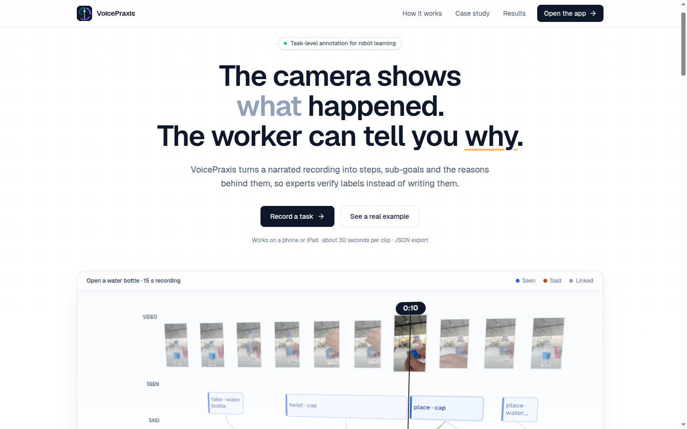
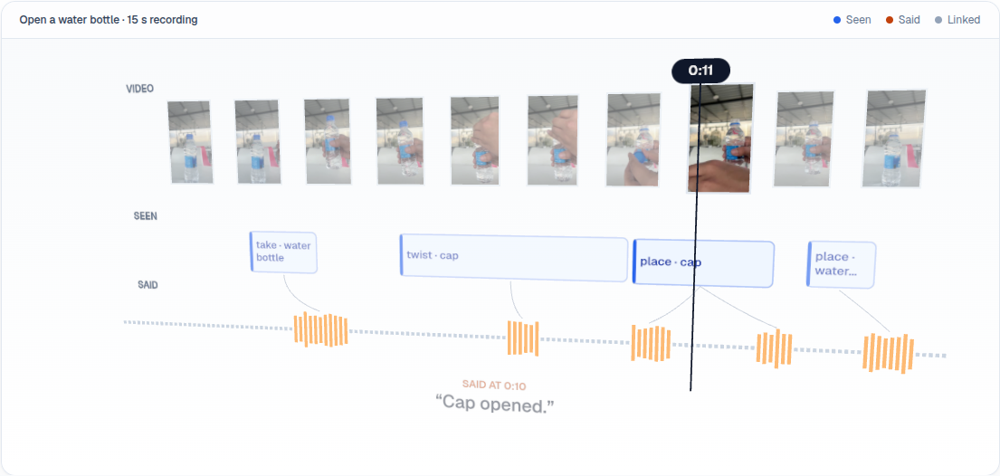
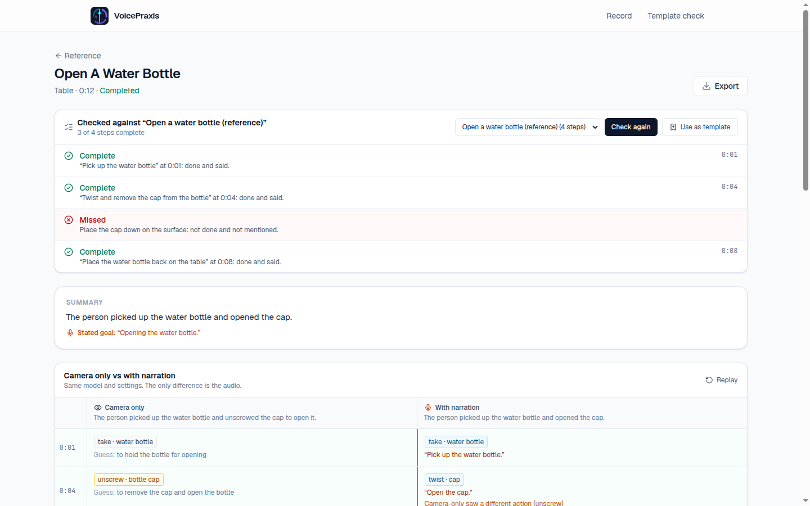
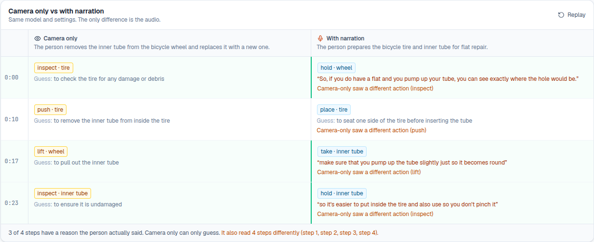
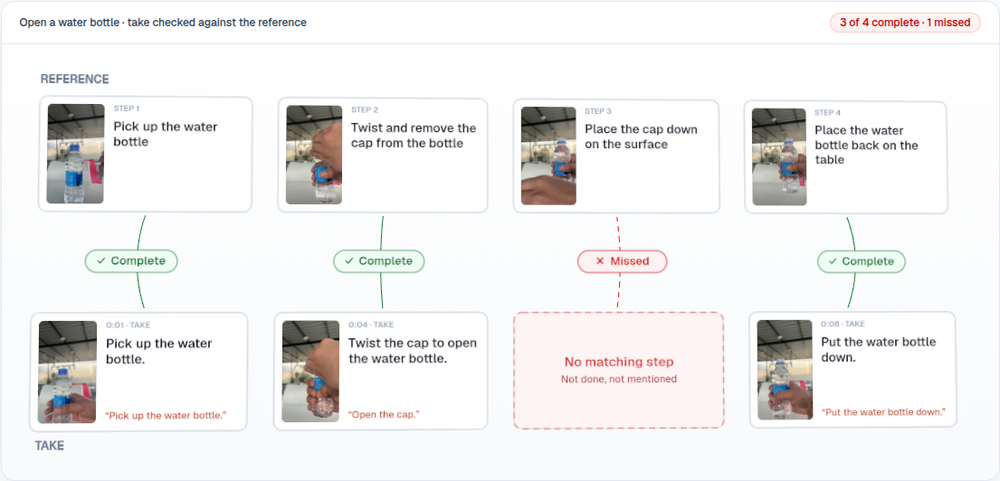
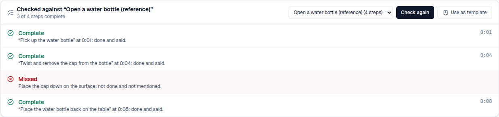
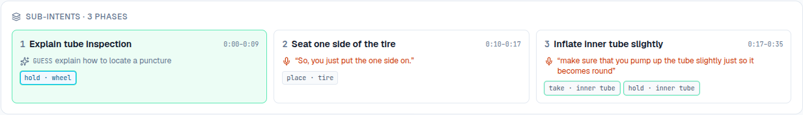

<div align="center">


# VoicePraxis

**Task-level robot training data from narrated video.**
Workers say what they are doing and why while they work. VoicePraxis turns the recording into steps, sub-goals and the reasons behind them, checks each take against an expert reference, and hands experts labels to verify instead of labels to write.

[Live product](https://voice-praxis-tau.vercel.app) · [Evidence](#evidence) · [Business case](#business-case) · [How it compares](#how-it-compares) · [Architecture](#architecture)



</div>

---

## Summary

| | |
|---|---|
| **Problem** | Robot-learning datasets need *task-level* labels: the steps, their order, and why each is done that way. Vision models label what is visible; the purpose of an action is never in the pixels, and annotators watching later cannot recover it. |
| **Product** | Narration captured during the task, transcribed word by word and aligned to the video. Every step keeps what was **seen**, what was **said** and what the model **guessed**, separately. A reference check flags missed steps before a human looks. |
| **Evidence** | Live in production. About 33 s from upload to a reviewable episode. A skipped step was caught on every check. Without the audio, the same model misread 4 of 4 steps on one clip and missed 2 of 4 on another. |
| **Cost** | About **$0.30 per hour of video** added on top of an existing vision pipeline (speech-to-text only). |
| **Status** | Working end to end on phone and iPad, deployed, built in one day at the Awign Physical AI Hackathon. |

## The problem

Awign records more than **10,000 hours of head-mounted video a day** to train robots ([StartupFeed](https://startupfeed.in/?p=5493)). Today an AI tool pre-labels the footage and **experts verify every label**. Their stated need (problem statement b) is a streamlined, automated pipeline for *task-level* annotation ("opening a box"), not only 2D object detection.

Two things make that hard:

1. **Task-level labels need intent.** A robot learning to open a box needs the step, its order and the reason for doing it that way. The camera shows a hand pressing down; only the worker knows it is *to release the clip*.
2. **Every label costs expert time,** and the wrong ones cost the most. A tool that is confidently wrong about intent makes verification slower, not faster.

## The insight

**The person doing the task is the only one who knows why.** Ask them to talk while they work and capture it at the source: no second annotation pass, no one guessing intent afterwards.

```text
Scene → Task (one-line summary, stated goal) → Sub-goals → Steps
                                                    ├─ verb · object · tool      fixed vocabulary
                                                    ├─ what the camera saw       observed action
                                                    ├─ robot-style instruction   "Pump the tube slightly"
                                                    ├─ the reason they SAID      quoted, linked to the exact sentence
                                                    └─ the model's guess         labelled as a guess
```

Evidence and inference are never mixed. A reviewer always knows which statement came from the video, which from the worker and which from the model.

## Product

### One episode, three channels

Video frames, the steps the model saw and the narration waveform on one timeline, from a real 15-second recording. Each sentence is linked to the step it happened in.



### The review workspace

Record on a phone or upload. About half a minute later the expert gets the video, the task summary, sub-goals and an editable panel for every step. Corrections are stored separately from the model output and travel with the export, so every change is auditable.



### Camera only versus narration

The same clip through the same model with the same settings; the only difference is the audio. On the bike-tube clip, the camera-only run read all four steps as different actions and described the task backwards ("removes the inner tube and replaces it"). With narration, three of four steps carry the reason the person actually gave.



### Template check: record the expert once, check every take

Upload one narrated reference and confirm its steps. Every later take is compared with it by intent, using both actions and narration. Steps that cannot be matched get a second, targeted look at the video. The verdict for each step is decided by rules, not by the model:

| Status | Meaning |
|---|---|
| Complete | Done and said |
| Not narrated | Done, but not mentioned |
| Said, not seen | Mentioned, but not visible |
| **Missed** | Not done and not mentioned |
| Skipped on purpose | Not done, and they said why |
| Unclear | Not visible and nothing said to confirm it: a person should check |
| Out of order / Extra | Needs a look |





### Sub-goals and spoken markers

Each phase of the task carries the goal the person stated, or a labelled guess when they did not. Head-cam recordings start with adjusting the mount and small talk, so the worker says **"capture"** when ready and **"finish"** when done, and the recording is cut to that span using word-level timestamps. This came from mentor feedback during the hackathon.



## Evidence

All measured on the live system during the build: our own clips, scored by us. Exploratory, not a benchmark.

| Measure | Result |
|---|---|
| Upload to reviewable episode (35 s clip) | 27 to 57 s, median about **33 s** (32 runs) |
| Template check, reference against itself | **4 of 4 complete** |
| Template check, take that skipped "put the cap down" | **3 of 4, that step flagged as Missed**, identical on every repeat check |
| Same reference footage with the audio muted | The first annotation pass missed **2 of 4 steps**. With the second look, steps are marked **Not narrated** (or **Unclear** where the step happens out of frame): never Missed, never Complete |
| Camera only versus narration (bike clip) | Camera only misread **4 of 4** steps; with narration, 3 of 4 steps carry a spoken reason |
| Narration timing | Within about 1 s of the video's own caption timings |
| Noisy head-cam clip (nail gun) | A general model heard "Yo, watch the not bind yourself"; the two-stage pipeline recovered *"it'll bind cuz it drops"* |

The muted test shows that narration does more than supply reasons. On identical footage it was the difference between finding every step and missing half of them.

## Business case

**It fits the workflow that already exists.** Workers already record; experts already verify. VoicePraxis adds one habit (talk while working) and changes what the expert receives: steps with reasons attached and missed steps already flagged.

**The incremental cost is small and predictable.** Awign already runs a vision pre-labeller, so the comparable cost is only what narration adds:

| | Per hour of video | At 10,000 hours a day |
|---|---|---|
| Speech-to-text, word-level timestamps ($0.005 per minute list price) | about **$0.30** | about **$3,000 a day** |

Our full pipeline including the video model costs about $1.15 to $1.20 per hour (measured token usage), shown for reference only.

**The comparison is capability, not price.** Manual annotators cannot recover a demonstrator's intent at any price, because they were not there. Crowdsourced robot instructions cost about $0.70 per label and come out noisy: one dataset has 104 unique instructions across 39,350 episodes ([ALFRED](https://arxiv.org/pdf/1912.01734), [MolmoAct2](https://arxiv.org/pdf/2605.02881)).

**What compounds.** Every narrated hour produces reasons linked to actions, a kind of data that vision-only pipelines and after-the-fact annotation do not produce. The same capture also feeds the next problems Awign named:

| Next step | What it unlocks |
|---|---|
| Validation on Awign footage with a scored test set | Measured accuracy on real production data, not our own clips |
| Automated recording QC (problem a) | Reject bad takes before review: hands out of frame, no narration, wrong task |
| Diversity filtering (problem c) | The `verb · object` vocabulary makes "100 hours of the same scenario" countable |
| Indian-language narration | Workers speak in their own language; labels in English |
| Ask "why?" on the spot | Questions for steps with no stated reason, answered before the worker leaves |
| Training exports | EPIC-KITCHENS-style action CSV and language-segment JSONL |

## How it compares

| Existing approach | Where its language comes from | What VoicePraxis does differently |
|---|---|---|
| Vision-only auto-labelling | The model's reading of the pixels | Adds the worker's stated reasons; model guesses stay labelled as guesses |
| Ego4D dense narration | Two third-party annotators per clip, 13.2 sentences a minute | No second annotation pass; the language comes from the person who did the task |
| EPIC-KITCHENS | Participants narrate their own video afterwards | Narrated live, aligned automatically with word timestamps |
| Ego-Exo4D expert commentary | Coaches comment on skilled activity | The reason comes from the worker, at no extra labour |
| HowTo100M narrated web video | Speech recognition; about half of clip-narration pairs misaligned | Statements explaining consequences are discarded there as not visually alignable. Those are the reasons, and we keep them |
| Crowdsourced robot instructions | About $0.70 per annotation, noisy | Instruction and reason from the demonstrator, at capture time |
| Mistake detection (Assembly101, EgoPER, CaptainCook4D) | Models trained per dataset | No training: one reference recording. Statuses map to their error types (omission to Missed, addition to Extra), plus a narration dimension |

<details>
<summary>Sources</summary>

[Ego4D](https://arxiv.org/pdf/2110.07058) · [NaQ (Ego4D narration statistics)](https://arxiv.org/pdf/2301.00746) · [EPIC-KITCHENS](https://arxiv.org/pdf/2005.00343) · [Ego-Exo4D](https://openaccess.thecvf.com/content/CVPR2024/html/Grauman_Ego-Exo4D_Understanding_Skilled_Human_Activity_from_First-_and_Third-Person_Perspectives_CVPR_2024_paper.html) · [MIL-NCE](https://arxiv.org/pdf/1912.06430) · [Temporal Alignment Networks](https://openaccess.thecvf.com/content/CVPR2022/papers/Han_Temporal_Alignment_Networks_for_Long-Term_Video_CVPR_2022_paper.pdf) · [ALFRED](https://arxiv.org/pdf/1912.01734) · [MolmoAct2](https://arxiv.org/pdf/2605.02881) · [Dense language annotations](https://arxiv.org/pdf/2605.17077) · [CaptainCook4D](https://arxiv.org/html/2312.14556v4) · [Mistake analysis review](https://arxiv.org/pdf/2510.19292) · [Gemini pricing](https://ai.google.dev/gemini-api/docs/pricing) · Awign context: [StartupFeed](https://startupfeed.in/?p=5493), [ThirdAI case study](https://www.thirdaiautomation.com/case-studies/awign-robotics-training-data-annotation)
</details>

## Architecture

```text
Phone / iPad (Next.js on Vercel)
   │ upload                                            ▲ live status · review · correct · export
   ▼                                                   │
FastAPI on Modal (CPU, Mumbai routing) ────────────────┘
 1. Prepare   ffmpeg: H.264 playback, 16 kHz audio
 2. Listen    gemini-3.5-transcribe: word-level timestamps, the authoritative transcript
 3. Trim      optional "capture" ... "finish" cut
 4. Watch     gemini-3.5-flash-lite: video at 4 fps plus the transcript → steps, sub-goals, reasons (strict JSON schema)
 5. Link      our code: ids, every cited sentence must exist, sub-goal grouping, guards against run-on output
 6. Optional  camera-only run in parallel · template check with a second look for unmatched steps
 7. Store     Modal Volume (video, served with range requests) · Modal Dict (episodes, templates)
```

| Decision | Why |
|---|---|
| Two-stage speech (dedicated speech-to-text, then video) | On a noisy nail-gun clip the video model's own transcript was fragments; the speech model recovered the key sentence |
| A reason must say *why* | "Cap down" describes; "so it doesn't pinch" explains. Only explanations are stored as reasons |
| Code decides, the model suggests | The model matches steps; deterministic code assigns statuses, checks every reference exists and writes the messages |
| Silence is weak evidence | With no speech in a take, a step the camera cannot see is flagged Unclear for a person, not Missed |
| Corrections stored apart from model output | Model output is never mutated; edits are applied on read and kept in the export for audit |
| Feature switches per environment | Side-by-side, templates and keywords switch on or off without a redeploy, so a failing feature never blocks the core |
| Mumbai routing | A 30 MB upload took about 3 s instead of about 18 s through the default route |

## Data format

One step from a production episode (JSON export, schema 0.2):

```json
{
  "id": "action-03",
  "start": 17.0, "end": 23.6,
  "verb": "take", "object": "inner tube", "tool": "pump",
  "observed_action": "The person picks up the inner tube and begins to pump it slightly.",
  "instruction": "Pump up the inner tube slightly so it becomes round.",
  "stated_reason": {
    "text": "make sure that you pump up the tube slightly just so it becomes round",
    "source": "narration",
    "evidence_ref": "speech-07"
  },
  "inferred_reason": "to give the tube shape for easier installation",
  "attempt": "first", "outcome": "success",
  "review_status": "unreviewed", "human_corrections": []
}
```

Each episode also carries the word-timed `narration`, `subtasks` with stated or guessed intents, `pending_questions` for decision steps with no reason, `template_check`, the camera-only `video_only` run, and a `pipeline` block (models, frame rate, prompt version, keyword cut) so every label is traceable. Export as JSON, or as a zip with the video.

## Built in one day

Hackathon rules: nothing built before October 10, 2026. Every milestone below is in the commit history (IST).

| Time | Milestone |
|---|---|
| 11:39 | First commit |
| 12:50 | Seven model settings tested; Flash Lite at 4 fps chosen on measured quality and speed |
| 13:16 | Live pipeline on Modal: upload, ffmpeg, model, episode JSON |
| 14:57 | Two-stage speech, sub-goals, one-line summary |
| 15:19 | **mvp-v1**: all MVP checks pass on the live site; first phone recording end to end |
| 15:45 | **v1.1**: camera only versus narration, side by side |
| 17:16 | **v1.2**: template check and capture/finish trimming |
| 17:38 | Prompt v4: a reason must say why |
| 21:07 | Product site: landing page, 3D episode and case study from real output, new identity |
| 22:10 | Template check second look; silent takes flag unseen steps as Unclear |

Every change went branch, separate test backend, pull request, production, live check. Production was never broken.

## Run it yourself

<details>
<summary>Backend (Python 3.12, uv, Modal)</summary>

```bash
cd backend
uv sync
cp .env.example .env                       # add GEMINI_API_KEY (comma-separate several keys to rotate)
modal secret create gemini GEMINI_API_KEY=<key> --env main
modal secret create vp-flags SIDE_BY_SIDE=1 TEMPLATES=1 KEYWORDS=1 COPILOT=0 REVIEW_QUEUE=0 INDIC=0 VISION_OVERLAY=0 --env main
modal deploy app.py --env main             # prints the API URL
scripts/smoke.sh <api-url>                 # end to end: upload, analysis, edit, export
```
</details>

<details>
<summary>Frontend (Next.js)</summary>

```bash
cd frontend
npm install
echo "NEXT_PUBLIC_API_BASE=<api-url>" > .env.local
npm run dev                                # http://localhost:3000
```
On Vercel: root directory `frontend`, environment variable `NEXT_PUBLIC_API_BASE`.
</details>

<details>
<summary>API</summary>

| Method | Path | Purpose |
|---|---|---|
| POST | `/episodes` | Upload a clip (`file`; optional `template_id`, `purpose=reference`), returns `{id}` |
| GET | `/episodes/{id}` | Live status (`converting → listening → trimming → analysing → linking → checking → ready`) and the episode |
| PATCH | `/episodes/{id}` | Corrections: `{"changes": [{"target": "action-03", "field": "observed_action", "value": "..."}]}` |
| GET | `/episodes/{id}/export?format=json\|zip` | Download |
| GET | `/episodes/{id}/video` | Playback (range requests) |
| GET/POST/PATCH/DELETE | `/templates...` | References |
| POST | `/episodes/{id}/check` | Check, or re-check, an episode against a template |
| GET | `/config` | Feature switches |
</details>

## Limitations

- These are **language and reason annotations for human demonstration video**, not robot-control data: no robot states or actions, so not LeRobot- or RLDS-ready yet.
- **Results are exploratory:** our own clips, scored by us. Validation on production footage is the first funded milestone.
- **The model varies between runs.** References are confirmed by a person, model guesses are labelled as guesses, and steps the camera cannot see are flagged rather than decided.
- **Confidence is not a calibrated probability.**

---

<div align="center">
Built at the Awign Physical AI Hackathon, Bengaluru · October 10–11, 2026
</div>
